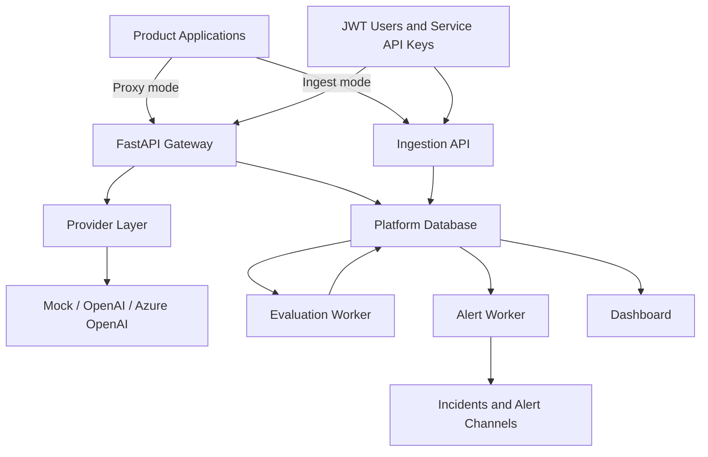
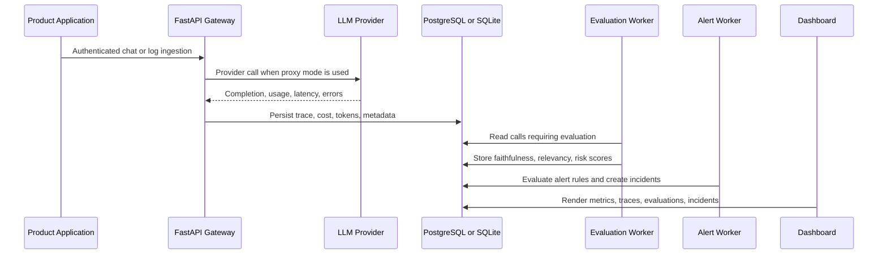
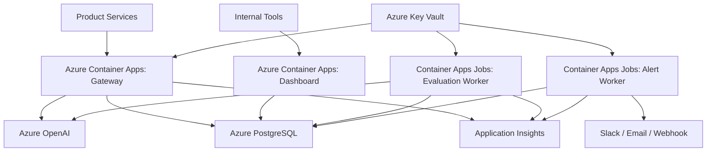
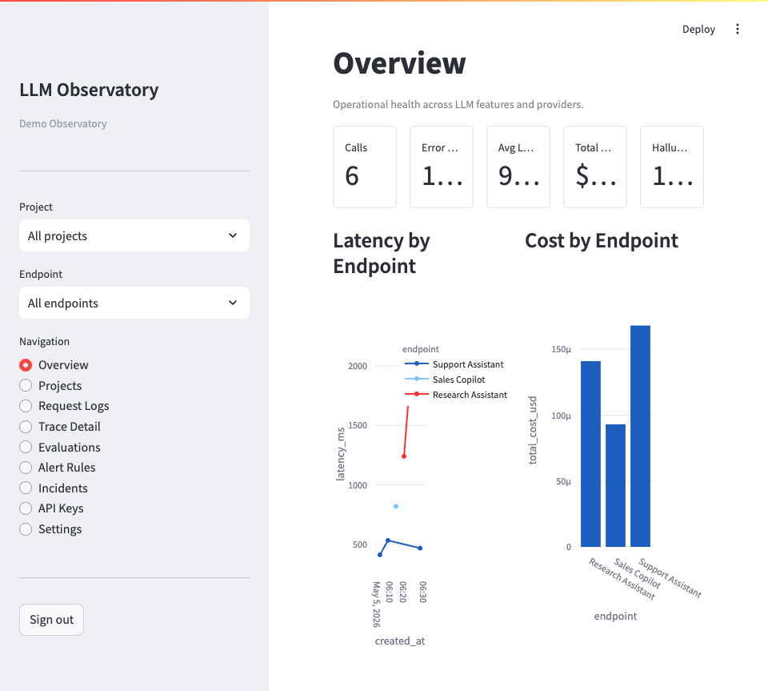
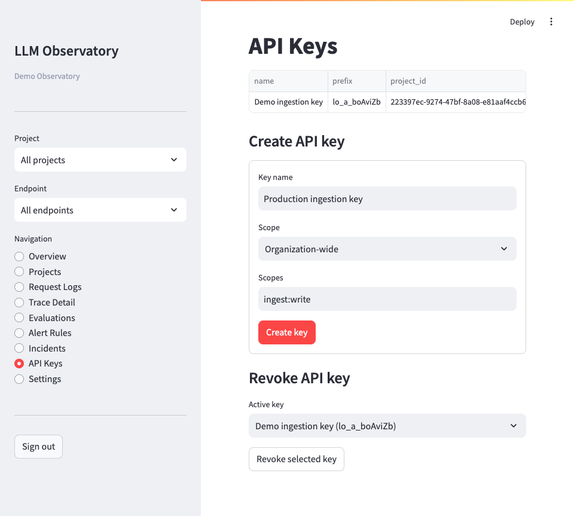

# LLM Observatory

Production-oriented monitoring for LLM quality, hallucination risk, latency, token usage, endpoint-level cost, and evaluation drift.

## Problem Statement

LLM-powered features can degrade silently. A prompt change, model swap, retrieval issue, or traffic spike can increase hallucinations, latency, and cost before application health checks notice anything. This project implements an observability platform that captures LLM calls, evaluates response quality, supports organization-scoped ingestion, and surfaces operational metrics.

## Business Use Case

An organization has multiple product features calling an LLM: support automation, sales assistance, and research workflows. Engineering needs visibility into which endpoint is expensive, which responses are low quality, and whether hallucination risk is increasing. The observatory provides a local-first implementation with a path to Azure OpenAI, PostgreSQL, Container Apps, Key Vault, and Application Insights.

## Architecture

LLM Observatory is organized around a clear product boundary: applications send LLM traffic through the gateway or submit completed traces through the ingestion API; the platform persists telemetry, runs evaluations, evaluates alert rules, and exposes operational views through the dashboard.

### Service Boundary



### Data Flow



### Forward Azure Deployment



### Dashboard Preview



### Incident Operations


### API Key Management



## Capabilities

- Gateway endpoint for centralized LLM calls
- Organization, user, project, endpoint, and API key management APIs
- JWT user authentication and service API key ingestion
- Role-based access control for owner, admin, engineer, and analyst roles
- PostgreSQL-compatible SQLAlchemy persistence with Alembic migrations
- Request, response, latency, token, cost, endpoint, session, and status logging
- DuckDB-backed local metrics store
- Deterministic mock LLM mode for no-key demos
- OpenAI and Azure OpenAI provider modes through environment variables
- Batch LLM-as-judge or heuristic evaluation
- Hallucination, faithfulness, and relevancy scoring
- Streamlit dashboard with latency, cost, logs, and evaluation results
- Alert rules, incident creation, acknowledgement, and resolution
- Dashboard API key creation and revocation workflow
- Prometheus-compatible `/metrics` endpoint and request correlation headers
- GitHub Actions CI for automated test validation
- Optional Docker Compose configuration for API, dashboard, PostgreSQL, and workers
- Azure deployment placeholders without committed secrets

## Metrics

| Category | Metrics |
| --- | --- |
| Usage | total calls, calls by endpoint, session id |
| Latency | per-call latency, average latency |
| Cost | prompt tokens, completion tokens, total cost, cost by endpoint |
| Quality | faithfulness score, relevancy score, hallucination flag |
| Reliability | status, failed call count, error text |

See [docs/metrics.md](docs/metrics.md) for metric definitions.

## Enterprise Backend APIs

Implemented backend foundations:

- [API reference](docs/api.md)
- [Authentication and authorization](docs/auth.md)
- [Database and migrations](docs/database.md)
- [Dashboard architecture](docs/dashboard.md)
- [Evaluation pipeline](docs/evaluation.md)
- [Alerting and incidents](docs/alerting.md)
- [Operations](docs/operations.md)
- [Security](docs/security.md)
- [Roadmap](docs/roadmap.md)
- [Customer demo guide](docs/demo.md)

## Quick Start

Python 3.11+ is required.

```bash
cd 01-llm-observatory
cp .env.example .env
uv venv .venv --python 3.11
source .venv/bin/activate
uv pip install -r requirements.txt
alembic upgrade head
python storage/db.py
python demo/seed_data.py
```

Run the gateway:

```bash
uvicorn gateway.gateway:app --reload --port 8001
```

Run the dashboard in another terminal:

```bash
streamlit run dashboard/app.py --server.port 8510
```

Open:

- Gateway health: `http://localhost:8001/health`
- Dashboard: `http://localhost:8510`

## API Example

Register an organization owner:

```bash
curl -X POST http://localhost:8001/api/v1/auth/register \
  -H "Content-Type: application/json" \
  -d '{
    "organization_name": "Acme AI",
    "organization_slug": "acme-ai",
    "email": "owner@example.com",
    "password": "correct-horse-battery-staple"
  }'
```

Proxy a mock LLM call through the gateway:

```bash
curl -X POST http://localhost:8001/chat \
  -H "Content-Type: application/json" \
  -d '{
    "messages": [{"role": "user", "content": "What is 2+2? Answer in one word."}],
    "endpoint": "support-assistant",
    "session_id": "demo-001"
  }'
```

## Environment Configuration

Default mode requires no LLM API key:

```env
LLM_PROVIDER=mock
STORAGE_MODE=local
DATABASE_URL=sqlite:///storage/observatory.db
JWT_SECRET_KEY=replace_with_a_long_random_secret
API_KEY_PEPPER=replace_with_a_long_random_pepper
```

OpenAI mode:

```env
LLM_PROVIDER=openai
OPENAI_API_KEY=your_openai_api_key_here
OPENAI_CHAT_MODEL=gpt-4o
OPENAI_EVAL_MODEL=gpt-4o-mini
```

Azure mode, required only when Azure is available:

```env
LLM_PROVIDER=azure
AZURE_OPENAI_ENDPOINT=https://your-resource.openai.azure.com/
AZURE_OPENAI_KEY=your_azure_openai_key_here
AZURE_OPENAI_CHAT_DEPLOYMENT=gpt-4o
AZURE_OPENAI_EVAL_DEPLOYMENT=gpt-4o-mini
APPLICATIONINSIGHTS_CONNECTION_STRING=your_connection_string
AZURE_KEY_VAULT_URL=https://your-vault.vault.azure.net/
```

## Evaluation Workflow

Run batch evaluation for unevaluated calls:

```bash
python eval_engine/run_evals.py --limit 50
```

Run platform evaluation jobs:

```bash
python workers/evaluation_worker.py --limit 10
```

When `LLM_PROVIDER=mock`, the evaluator uses deterministic heuristic scoring. When `LLM_PROVIDER=openai` or `LLM_PROVIDER=azure`, it attempts LLM-as-judge evaluation and falls back to heuristic scoring if the judge call fails.

## Alerts

Run alert checks:

```bash
python alerts/slack_alerts.py
```

Run platform alert rules and incident creation:

```bash
python workers/alert_worker.py
```

## Demo Reset And Seed

For repeatable demos:

```bash
python demo/reset_demo.py
python demo/seed_platform_demo.py
```

If `SLACK_WEBHOOK_URL` is empty, the script prints the alert payload locally. If configured, it sends alerts to Slack.

## Docker

Docker is optional. The verified local path uses Python, SQLite, mock LLM mode, and the commands above. The Compose topology is included for reviewers who want container parity with PostgreSQL-backed deployment.

```bash
cp .env.example .env
docker compose up --build
```

Gateway: `http://localhost:8001`

Dashboard: `http://localhost:8501`

## Deployment

See [docs/deployment.md](docs/deployment.md) for the forward deployment path. Azure credentials are not required for local operation. They are required only for production deployment with Azure OpenAI, Key Vault, Application Insights, Container Apps, and production storage.

## Security Notes

- Secrets are loaded from environment variables.
- `.env` is excluded from source control.
- `.env.example` contains placeholders only.
- Azure Key Vault is the intended production secret store.
- JWT authentication and hashed service API keys are implemented for local backend API use.
- Entra ID/OAuth provider integration is tracked as a production roadmap item.

## Repository Structure

```text
.
├── alerts/
├── dashboard/
├── demo/
├── docs/
├── eval_engine/
├── gateway/
├── shared/
├── storage/
├── tests/
├── Dockerfile
├── docker-compose.yml
├── pyproject.toml
└── requirements.txt
```

## Professional Implementation Summary

This project demonstrates an end-to-end LLM observability workflow: centralizing LLM access through a gateway, capturing operational telemetry, calculating token cost, evaluating response quality, surfacing metrics through a dashboard, and preparing a clear path from local development to Azure production deployment.
