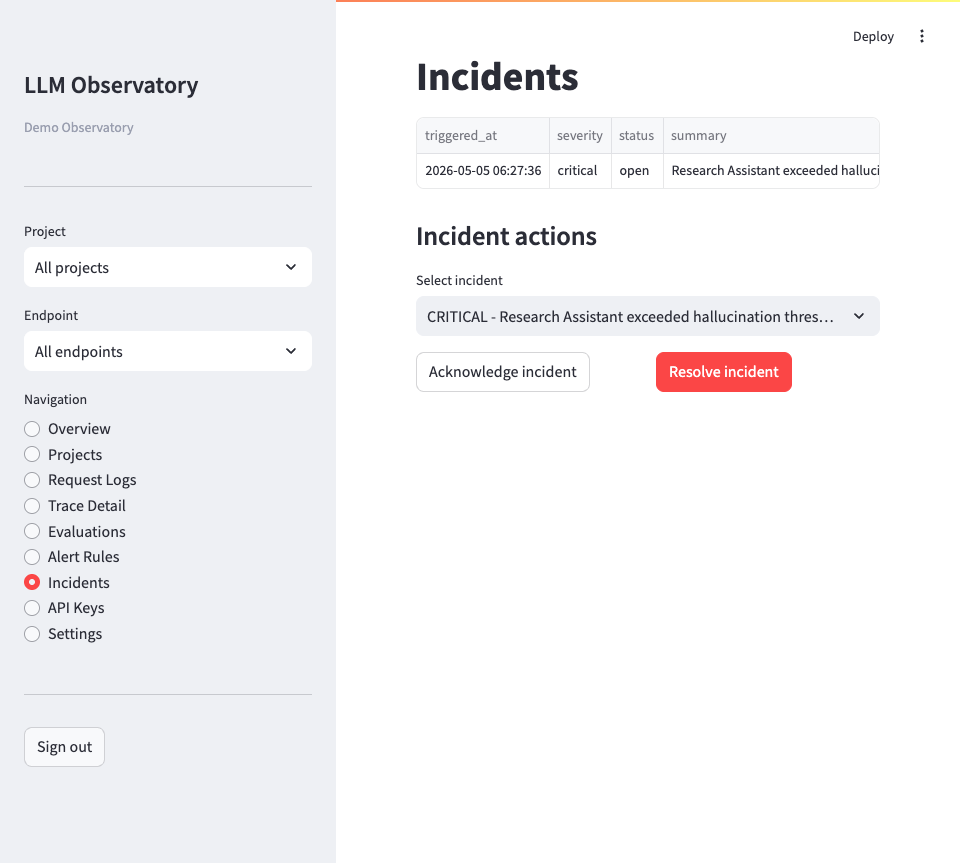
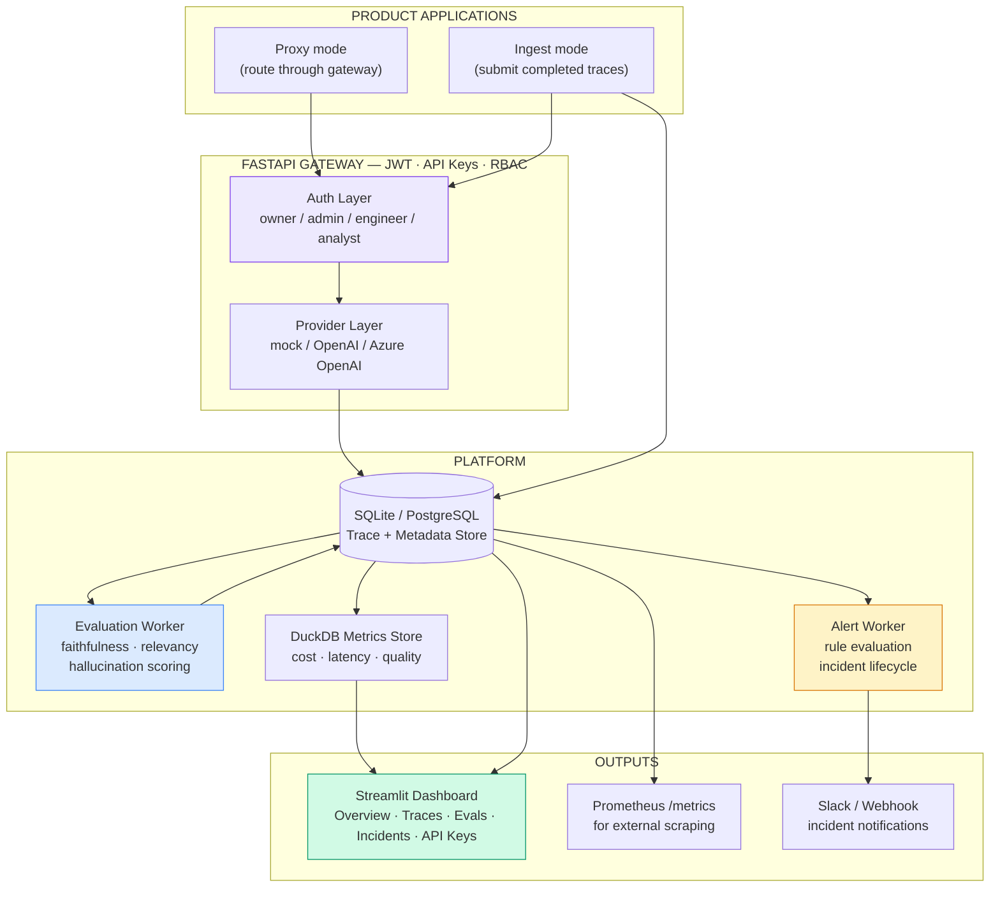
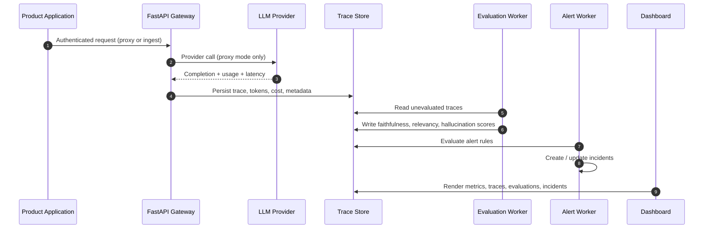
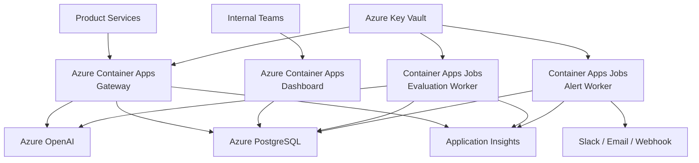

# LLM Observatory

> Centralized monitoring for LLM quality, hallucination risk, latency, cost, and evaluation drift — across all endpoints and providers.


---

## The Problem

LLM-powered features degrade silently. A prompt change, a model swap, a retrieval issue, or a traffic spike can increase hallucinations, latency, and cost before any application health check notices anything.

Engineering teams operating multiple LLM endpoints — support automation, sales assistance, research workflows — typically have no visibility into which endpoint is expensive, which responses are low quality, or whether hallucination risk is trending upward. Standard APM tools track HTTP status codes. They do not evaluate whether a response was faithful, relevant, or safe.

---

## What It Does

- **Centralizes LLM traffic through a gateway** — proxy mode routes calls through the observatory, capturing latency, token usage, and cost per request; ingest mode accepts completed traces from existing integrations
- **Evaluates response quality automatically** — faithfulness, relevancy, and hallucination scoring per call, using LLM-as-judge or deterministic heuristics
- **Alerts on quality and reliability thresholds** — configurable alert rules create incidents when metrics breach defined limits; incidents are tracked through acknowledge → resolve lifecycle

---

## Dashboard


*Latency by endpoint, cost by endpoint, call volume, error rate, hallucination flags — all filterable by project and endpoint.*

---



*Active incidents with severity, trigger timestamp, and resolution controls.*

---

## System Architecture



---

## Data Flow



---

## Azure Deployment



---

## Key Capabilities

| Capability | Detail |
|------------|--------|
| **Gateway proxy** | All LLM calls route through the gateway — one integration point, full trace capture |
| **Multi-org support** | Organization, project, endpoint, and API key isolation — built for multi-tenant deployments |
| **RBAC** | Four roles: owner, admin, engineer, analyst — scoped to organization |
| **Quality evaluation** | LLM-as-judge (faithfulness, relevancy, hallucination) with heuristic fallback |
| **Alert rules** | Configurable thresholds per metric — incidents created, acknowledged, and resolved in-platform |
| **Prometheus metrics** | `/metrics` endpoint for external scraping and Grafana integration |
| **Mock LLM mode** | Full platform runs without an LLM API key — deterministic responses for demos and CI |
| **Docker Compose** | Optional containerized topology: API + dashboard + PostgreSQL + workers |
| **Azure-ready** | Key Vault, Azure OpenAI, PostgreSQL, Container Apps, Application Insights paths documented |

---

## Metrics Captured

| Category | Metrics |
|----------|---------|
| **Usage** | Total calls, calls by endpoint, session ID |
| **Latency** | Per-call latency, average latency by endpoint |
| **Cost** | Prompt tokens, completion tokens, total cost, cost by endpoint |
| **Quality** | Faithfulness score, relevancy score, hallucination flag |
| **Reliability** | Status, failed call count, error text |

---

## Quickstart

```bash
# 1. Clone and set up environment
git clone https://github.com/manjunath-hanmantgad/LLM-Production-Monitoring.git
cd LLM-Production-Monitoring/01-llm-observatory
uv venv .venv --python 3.11 && source .venv/bin/activate
uv pip install -r requirements.txt

# 2. Configure
cp .env.example .env

# 3. Run migrations and seed demo data
alembic upgrade head
python storage/db.py
python demo/seed_data.py

# 4. Start the gateway
uvicorn gateway.gateway:app --reload --port 8001

# 5. Start the dashboard (separate terminal)
streamlit run dashboard/app.py --server.port 8510
```

| Service | URL |
|---------|-----|
| Gateway health | http://localhost:8001/health |
| Dashboard | http://localhost:8510 |
| Prometheus metrics | http://localhost:8001/metrics |

No LLM API key required — set `LLM_PROVIDER=mock` in `.env` for a fully functional demo.

---

## Configuration

| Variable | Default | Description |
|----------|---------|-------------|
| `LLM_PROVIDER` | `mock` | `mock`, `openai`, or `azure` |
| `STORAGE_MODE` | `local` | `local` (SQLite) or `postgres` |
| `DATABASE_URL` | `sqlite:///storage/observatory.db` | Database connection string |
| `JWT_SECRET_KEY` | — | Required — long random string |
| `API_KEY_PEPPER` | — | Required — long random string |
| `OPENAI_API_KEY` | — | Required when `LLM_PROVIDER=openai` |
| `SLACK_WEBHOOK_URL` | — | Optional — alert notifications |

Full variable reference including Azure and OIDC options: [`.env.example`](.env.example)

---

## Running Workers

Evaluation worker (scores unevaluated traces):

```bash
python workers/evaluation_worker.py --limit 10
```

Alert worker (evaluates rules, creates incidents):

```bash
python workers/alert_worker.py
```

Docker Compose (optional — runs all services including PostgreSQL):

```bash
docker compose up --build
```

---

## Azure Production Path

| Local | Azure Production |
|-------|-----------------|
| `LLM_PROVIDER=mock` or `openai` | Azure OpenAI (`LLM_PROVIDER=azure`) |
| SQLite (`STORAGE_MODE=local`) | Azure Database for PostgreSQL |
| `uvicorn` local process | Azure Container Apps |
| `.env` file | Azure Key Vault + Managed Identity |
| Prometheus scrape | Azure Application Insights |
| Slack webhook | Azure Logic Apps + Notification Hub |

Full deployment guide: [docs/deployment.md](docs/deployment.md)

---

## Further Reading

| Document | Contents |
|----------|---------|
| [docs/api.md](docs/api.md) | Full API reference |
| [docs/auth.md](docs/auth.md) | Authentication, JWT, API keys, RBAC |
| [docs/evaluation.md](docs/evaluation.md) | Evaluation pipeline and scoring |
| [docs/alerting.md](docs/alerting.md) | Alert rules and incident lifecycle |
| [docs/dashboard.md](docs/dashboard.md) | Dashboard architecture |
| [docs/deployment.md](docs/deployment.md) | Azure deployment steps |
| [docs/security.md](docs/security.md) | Security model and hardening |
| [docs/demo.md](docs/demo.md) | Customer demo guide |
