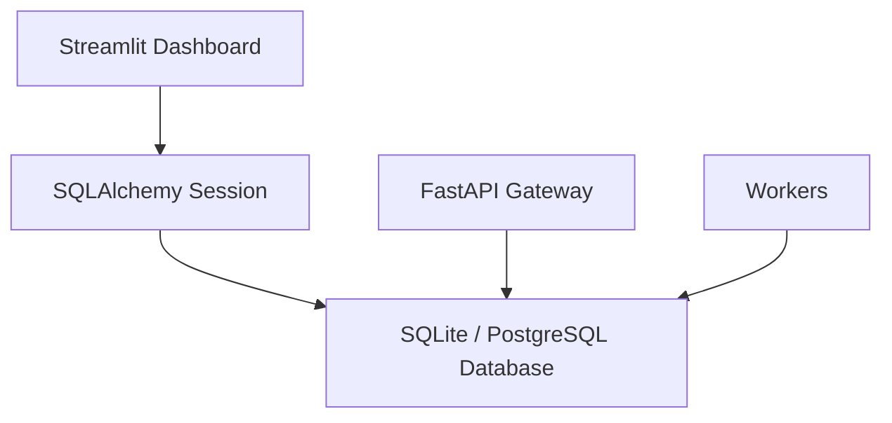
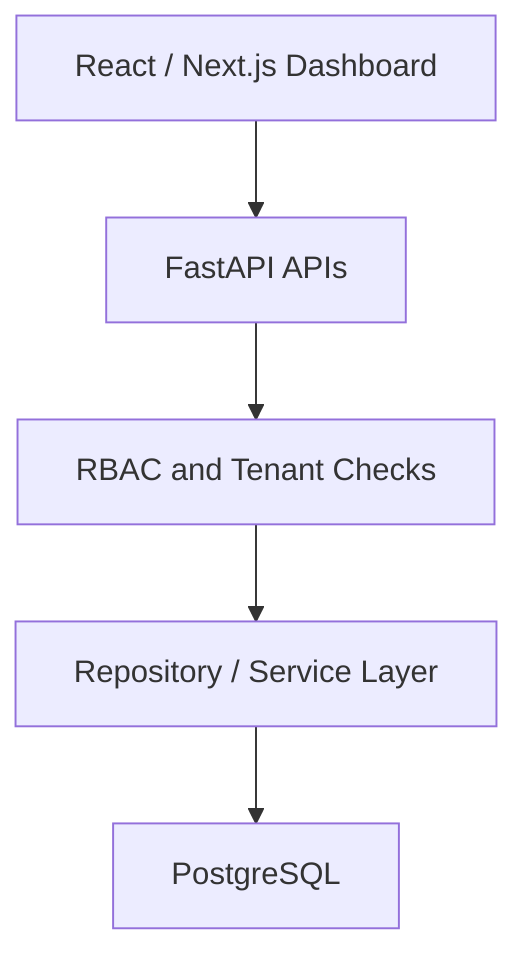

# Dashboard Architecture

The current dashboard is a Streamlit operations UI designed for local demos, internal review, and customer-style walkthroughs. It intentionally stays lightweight so the project can run without a separate frontend build pipeline.

## Current Boundary

The dashboard reads and writes through the same SQLAlchemy models used by the platform backend. This is acceptable for the local-first demo path because it keeps setup simple and avoids requiring a second service contract while the core backend is being hardened.

## Implemented Dashboard Workflows

- guided demo workspace creation
- login with demo organization
- overview metrics
- project and endpoint views
- request logs with filters and search
- trace detail view
- cost and latency analytics
- quality and evaluation analytics
- alert rule creation
- incident acknowledgement and resolution
- API key creation and revocation
- organization settings and audit log review

## Production Dashboard Path

For a production SaaS deployment, the dashboard should move behind the FastAPI service boundary:

The backend already exposes the core APIs needed for that transition:

- auth
- projects
- endpoints
- API keys
- ingestion
- metrics
- traces
- evaluations
- alert rules
- incidents

## Public Release Positioning

For the first public release, the Streamlit dashboard should be described as the local operations console. It is useful for reviewing the platform end to end without a frontend build step.

Roadmap items for a fully production-packaged dashboard:

- API-backed dashboard client
- React or Next.js frontend
- dedicated frontend tests
- role-specific navigation
- server-side pagination through API endpoints
- managed deployment through Azure Container Apps or Static Web Apps plus API service
