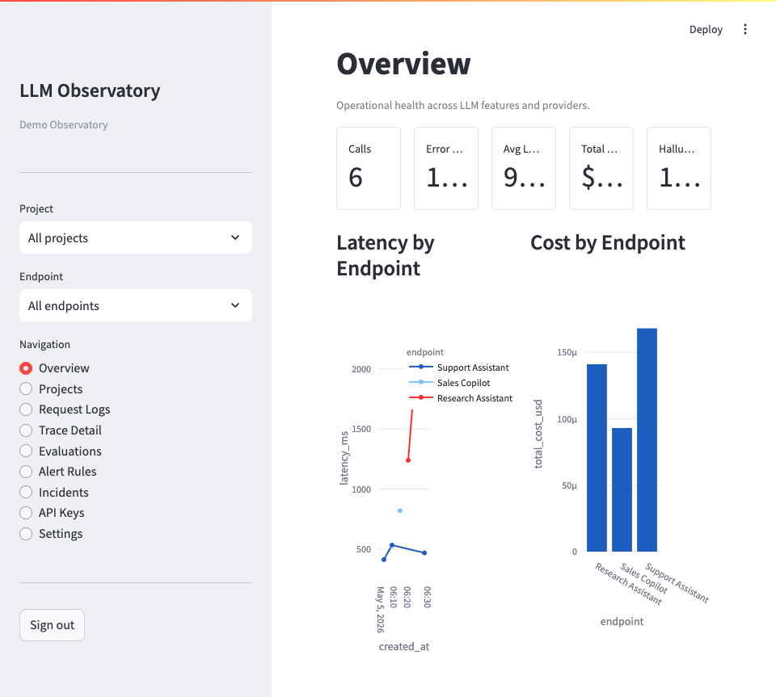

# Customer Demo Guide

This guide describes the current local customer-style demo flow.

## Preview



## Start

```bash
cd 01-llm-observatory
cp .env.example .env
source .venv/bin/activate
alembic upgrade head
streamlit run dashboard/app.py --server.port 8510
```

Reset and seed the platform demo from the command line:

```bash
python demo/reset_demo.py
python demo/seed_platform_demo.py
```

If the API is also needed:

```bash
uvicorn gateway.gateway:app --reload --port 8001
```

## Demo Flow

1. Open the dashboard.
2. Click **Load demo workspace**, or run the seed command above.
3. Review the overview metrics.
4. Open **Request Logs** and filter/search traces.
5. Open **Trace Detail** and inspect `trace-demo-004`.
6. Open **Evaluations** and show the hallucination flag and judge reasoning.
7. Open **Alert Rules** and show the hallucination threshold.
8. Open **Incidents** and show the open critical incident.
9. Open **API Keys** and explain service ingestion.
10. Open **Settings** and show tenant settings plus audit logs.

## Worker Commands

Run queued evaluation jobs:

```bash
python workers/evaluation_worker.py --limit 10
```

Evaluate alert rules and create incidents:

```bash
python workers/alert_worker.py
```

## Current Demo Scope

Implemented:

- local onboarding
- tenant/project/endpoints
- API key record
- request logs
- evaluation results
- alert rule
- incident
- incident acknowledgement and resolution
- API key creation and revocation
- audit log
- evaluation worker command
- alert worker command
- dashboard navigation

Later phases:

- external queue backend such as Redis
- production frontend packaging
